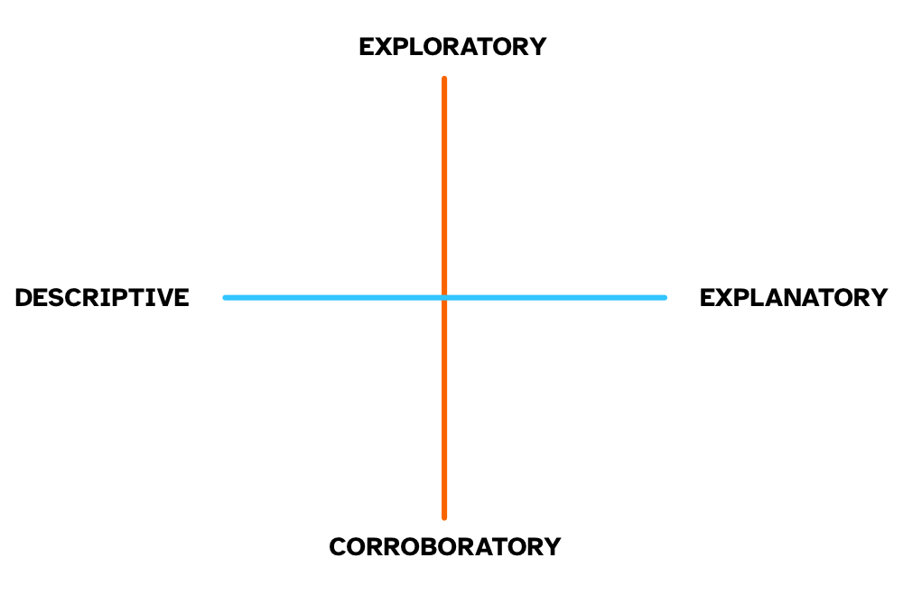
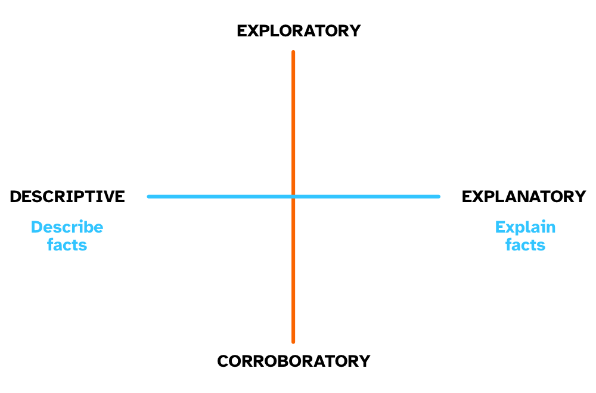
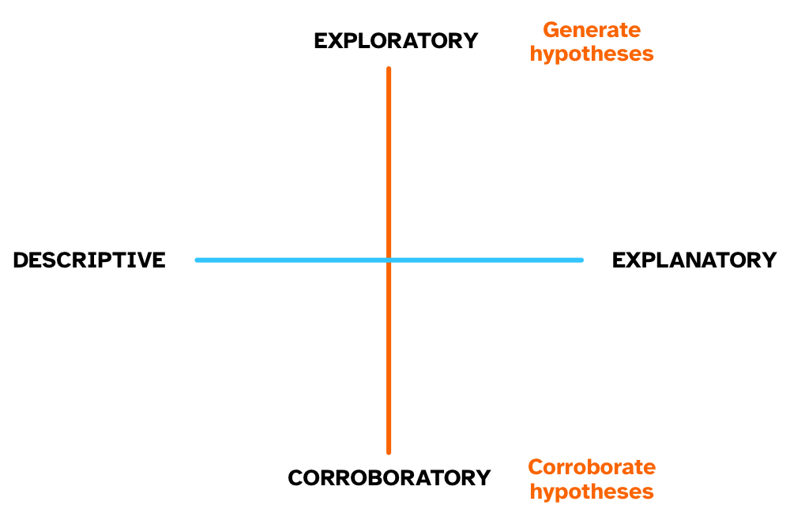
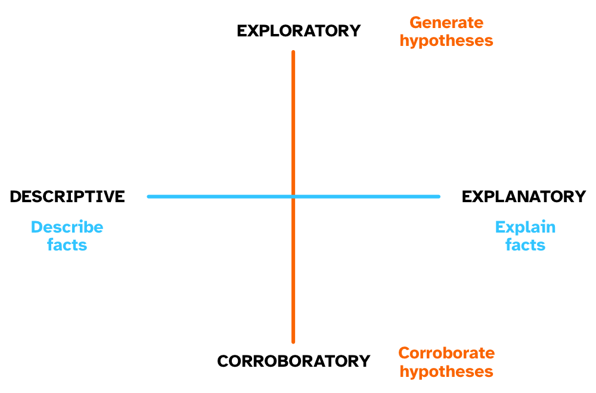

## 

```{=html}
<iframe allowfullscreen frameborder="0" height="100%" mozallowfullscreen style="min-width: 500px; min-height: 355px" data-src="https://app.wooclap.com/events/HUYFAK/questions/671b610e9a1fef6627b8007e" width="100%">

</iframe>
```

## Research

{fig-align="center"}

## Research process

{fig-align="center"}

## What is empirical research?

::: callout-note
### Empirical research

- **Empirical** = data

- Learning about the Universe through data and observation.
:::

. . .

::: callout-tip
### Etymology

From Wiktionary: <https://en.wiktionary.org/wiki/empiric#English>

Borrowed from Latin *empiricus*, from Ancient Greek ἐμπειρῐκός (*empeirĭkós*, "experienced"), from ἐμπειρία (*empeiría*, “experience, mere experience or practice without knowledge, especially in medicine, empiricism”), from ἔμπειρος (*émpeiros*, "experienced or practised in"), from ἐν (*en*, “in”) + πεῖρα (*peîra*, "a trial, experiment, attempt").
:::

## Axes of research types

{fig-align="center" width="500"}

## Descriptive vs explanatory

{fig-align="center" width="500"}

## 

```{=html}
<iframe allowfullscreen frameborder="0" height="100%" mozallowfullscreen style="min-width: 500px; min-height: 355px" data-src="https://app.wooclap.com/events/HUYFAK/questions/671915496cc4c8c454453be1" width="100%">

</iframe>
```

## Exploratory vs corroboratory

{fig-align="center" width="500"}

## 

```{=html}
<iframe allowfullscreen frameborder="0" height="100%" mozallowfullscreen style="min-width: 500px; min-height: 355px" data-src="https://app.wooclap.com/events/HUYFAK/questions/671917e6b610bf28821430e6" width="100%">

</iframe>
```

## Axes of research types

{fig-align="center" width="500"}

## Types of research objectives

::: callout-note
## Research objectives

**Establish facts**

- Fill a gap in knowledge.
- Accumulate evidence.

**Improve fit of framework to facts**

- Improve how well a framework can describe and explain a phenomenon.

**Compare fit of different frameworks to facts**

- Compare opposing hypotheses generated by two or more frameworks.
:::

## Types of research objectives: examples

::: callout-tip
## Establish facts

- What are the uses of the Sanskrit verb *gam* 'to go'.
:::

. . .

::: callout-tip
## Improve fit of framework to facts

- Strong exemplar-based models preclude the possibility of abstract representations.
- If the results of a study indicate that certain categorisation tasks seem to involve abstract representations, we update our exemplar-based framework to include abstractions.
:::

. . .

::: callout-tip
## Compare fit of different frameworks to facts

- In the sentence "Stefano emailed Bert. I saw *him* in DSB.", the subjecthood hypothesis states that *him* refers to *Stefano*, while under the "syntactic parallelism" hypothesis *him* refers to *Bert*.
- We test these hypotheses using empirical data.
:::

## Researcher orientation

::: callout-note
## Researcher orientation

The **researcher orientation** is the combination of every aspect specific to an individual researcher that shape how the researcher understands, approaches and practises research.

This includes, but it is not limited to, lived experiences, social positionality, philosophical stance, personal beliefs, methodological theory, and more.
:::

. . .

::: callout-note
## Philosophical stance

Empirical methods in general and statistical methods in particular are not just tools in a vacuum.
:::

. . .

::: callout-tip
## Activity: your philosophical stance

1.  Does reality exist independently of how we perceive, describe, or understand it?

2.  How can we know whether our beliefs about reality are true?

3.  If two people or communities produce different but well-supported accounts of the same phenomenon, can both be true?
:::

. . .

You can read my researcher orientation here: <https://stefanocoretta.github.io/orientation.html>
