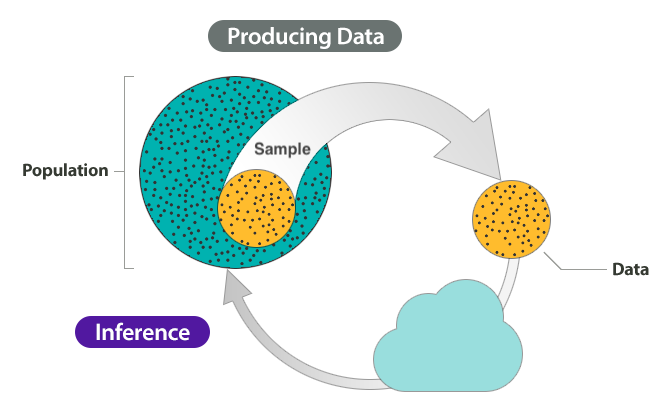
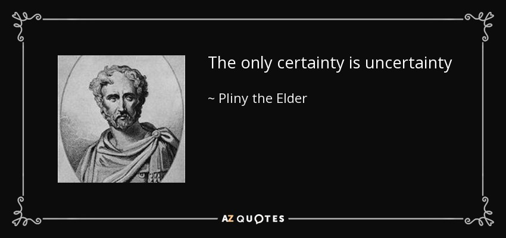
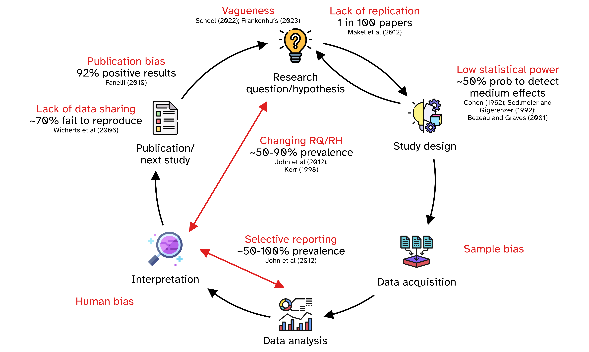

## Inference process

{fig-align="center"}

::: notes
Imbuing numbers with meaning is a good characterisation of the "inference process".

We have a question about something.

Let's imagine that this something is the population of British Sign Language signers.

We want to know whether the cultural background of the BSL signers is linked to different pragmatic uses of the sign for BROTHER.

But we can't survey the entire population of BSL signers.

NOTE: *Population* can be a set of anything, not just a specific group of people.
For example, the words in a dictionary can be a "population"; or the antipassive constructions of Austronesian languages; or ...
:::

## Inference process

{fig-align="center"}

::: notes
We take a **sample** from the population.

This is our empirical data (the product of observation).

How do we go from data/observation to answering our question?

We can use **inference**.

**Inference** is the process of understanding something about a population based on the sample (aka the data) taken from that population.
:::

## Inference is not infallible

However, inference based on data does not guarantee that the answers to our questions are right/true.

. . .

In fact, any observation we make comes with a degree of **uncertainty and variability**.

{fig-align="center"}

::: notes
EXTRA: Check out this article: <https://www.scientificamerican.com/article/if-you-say-science-is-right-youre-wrong/>

EXTRA: Find out about Popper's view of falsification and fallibilism.

So we have to deal with:

- Uncertainty in any observation of a phenomenon.

- Variability among different observations of the same phenomenon.
:::

## What is statistics?

::: {.callout-tip .incremental}
### Statistics helps us **quantifying uncertainty and variability**.

- Statistics is the **science** concerned with developing and studying methods for collecting, analyzing, interpreting and presenting empirical data. (From [UCI Department of Statistics](https://www.stat.uci.edu/what-is-statistics/))

- Statistics is the **technology** of extracting information, illumination and understanding from data, often in the face of uncertainty. (From the [British Academy](https://www.thebritishacademy.ac.uk/blog/what-is-statistics/))

- Statistics is a **mathematical and conceptual** discipline that focuses on the relation between data and hypotheses. (From the [Standford Encyclopedia of Philosophy](https://plato.stanford.edu/entries/statistics/))

- Statistics as the **art** of applying the science of scientific methods. (From [ORI Results](https://www.oriresults.com/articles/blog-posts/the-art-of-statistics/), [Nature](https://www.nature.com/articles/d41586-019-00898-0))

:::

## Statistic is both a science and an art

::: {.callout-tip appearance="simple"}
It is a *science* in that its methods are basically systematic and have general application and an *art* in that their successful application depends, to a considerable degree, on the skill and special experience of the statistician, and on his knowledge of the field of application.

—L.H.C. Tippett
:::

## What statistics is NOT

::: {.callout-important appearance="simple"}
- Statistics is **not maths.**

- Statistics is **not about hard truths.**

- Statistics is **not a purely objective** endeavour.

- Statistics is **not a substitute** of common sense and expert knowledge.

- Statistics is **not just** $p$-values and significance testing.
:::

## The research crisis: Questionable Research Practices

{fig-align="center"}

## Two approaches to statistics

::: callout-note
### Null Hypothesis Significance Testing (NHST)

  - Focusses on rejecting a null hypothesis $H_0$ (typically, a *nil* hypothesis, i.e. a difference of exactly 0).
  
  - Based on *p*-values.

:::

. . .

::: callout-note
### Bayesian statistics

  - Focusses on estimating the probability of hypotheses given the observed data and prior beliefs.
  
  - Allows us to quantify uncertainty about hypotheses.

:::

## Null Hypothesis Significance Testing

::: callout-note
### Context

You obtain data from two groups: A and B. You run a significance test (like a *t*-test or a $\chi^2$-test) which compares the data of the groups and you get a *p*-value.
:::

. . .

::: callout-tip
### *p*-value: definition

A *p*-value is the probability of obtaining a difference as large or larger as the one you observed, given that there is no difference.

If the *p*-value is smaller than a threshold, you reject $H_0$ (that there is no difference).

:::

. . .

::: callout-warning
### Careful

- In NHST, the null hypothesis $H_0$ is always true.
- You can only reject the null hypothesis $H_0$, not disprove it nor prove it.
- The *p*-value is not about the probability that the difference is not 0 (the alternative hypothesis, $H_1$). Rejecting $H_0$ does not mean $H_1$ is true.
- The *p*-value does not tell you anything about the replicability of the results.
:::

## Further resources

- Data Analysis @ LEL: <https://uoelel.github.io>

- Textbook: <https://stefanocoretta.github.io/qdal/>
